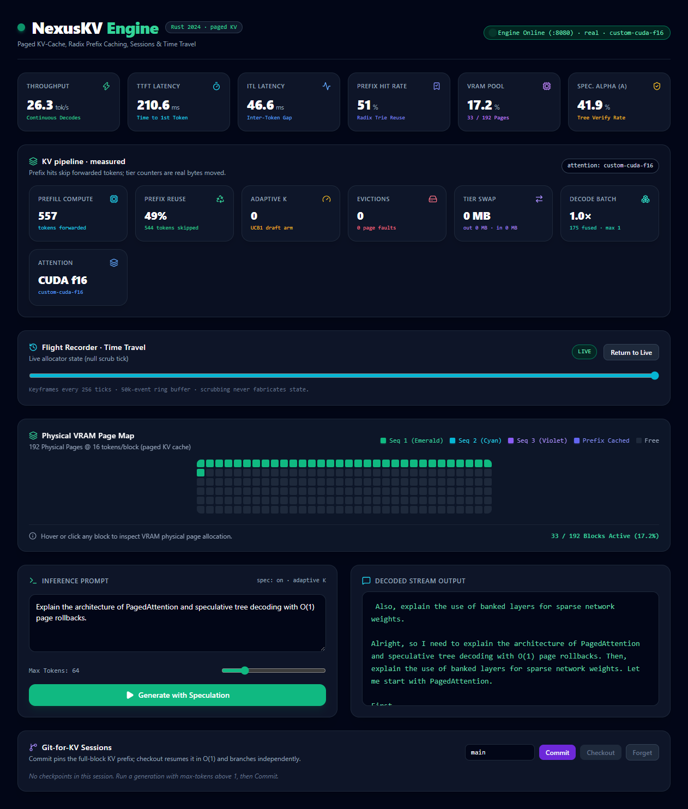
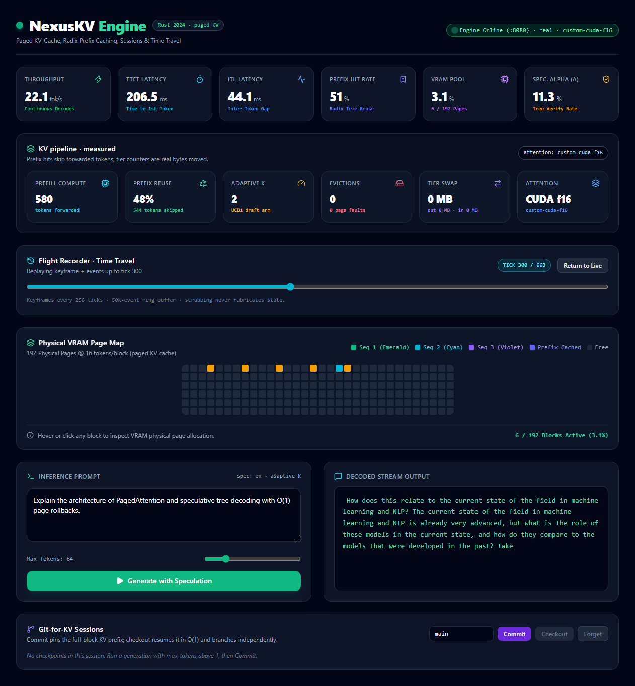

# NexusKV Engine

<div align="center">


**Paged KV-cache, radix prefix caching, continuous batching, speculative decoding,
Git-like KV sessions, time travel, and tiered KV memory — in Rust 2024.**

</div>

NexusKV is an inference runtime for transformer decoding. It treats the KV cache
as a paged, reference-counted resource: blocks move through an explicit state
machine, shared prefixes live in a radix trie, and evicted blocks can spill to
host memory and NVMe without changing model semantics. A single-writer actor
owns the allocator, scheduler, executor, and session store, while HTTP/SSE
handlers relay measured telemetry to clients and the dashboard.

> **Measurement policy.** The default `cargo run` starts a deterministic **mock
> executor**. Mock mode is logged at startup, reported as `"executor": "mock"`
> by `/v1/models` and `/v1/metrics`, and shown as a MOCK banner in the
> dashboard. Real dense Qwen inference runs on CPU with the `candle-model`
> feature or on an NVIDIA GPU with `cuda`; the custom CUDA kernel is part of the
> GPU path. Allocator microbenchmarks and mock-mode
> token rates are never presented as inference throughput. Every benchmark in
> this document names its hardware, model, executor mode, and metric.

---

## Contents

- [Screenshots](#screenshots)
- [Current capabilities](#current-capabilities)
- [Target hardware and defaults](#target-hardware-and-defaults)
- [Architecture](#architecture)
- [Quickstart](#quickstart)
- [API](#api)
- [Benchmarks](#benchmarks)
- [Testing](#testing)
- [Project layout](#project-layout)
- [Known limitations](#known-limitations)
- [License](#license)

---

## Screenshots

Live dashboard captured on the target machine with real Qwen3-0.6B f16 weights,
`executor=real`, and the custom CUDA f16 decode kernel. The KV pipeline row shows
measured prefill/skipped tokens, adaptive K, evictions, tier swap bytes, and the
attention backend:



Time-travel replay at tick 300 of the same run: a recorded keyframe plus memory
events reconstructs the 6 active pages exactly. The HUD above keeps the last
measured live performance values; only allocator state is replayed:



---

## Current capabilities

| Area | State |
| --- | --- |
| Memory core | `Free`/`Active`/`Cached` state machine, radix trie, transactional prefix match/append/fork, copy-on-write tails, O(1) free-list guard, LRU eviction, pinned commits |
| Engine | Single-writer actor, continuous batching, chunked prefill, decodes-first scheduling, starvation-free admission, preemption |
| Serving | OpenAI-compatible chat completions, SSE generation, measured TTFT/ITL/tokens-per-second, client-disconnect aborts |
| Speculative decoding | Prompt-lookup n-gram drafter, distribution-exact rejection sampling, greedy verification, UCB1 adaptive `K` over `{0,2,4,8,16}` |
| Sessions | Commit pins full-block KV prefixes, checkout resumes in O(1) and branches independently, forget releases pins |
| Time travel | 50k-event ring buffer, keyframes at most 256 ticks apart, `GET /v1/timetravel?tick=N` |
| Tiering | Content-addressed host LRU plus NVMe spill, demand page-in on `Swapped` trie hits, fault-injection coverage, NKV2 dtype-tagged spill files |
| Real model | Dense Qwen3-0.6B (primary) and Qwen2.5-0.5B-Instruct (fallback) behind `candle-model` on CPU (f32) or `cuda` on GPU (f16); QK-norm, GQA, RoPE, SwiGLU, f32 norm/softmax accumulation |
| CUDA | f16 `paged_decode_attention` with f32 accumulation and GQA-correct head mapping, enabled for decode by `NEXUSKV_CUDA_ATTENTION=1`, launched on candle's stream with automatic gather fallback; plus `reshape_and_cache` and `copy_block` |
| Prefix hits | KV-valid trie blocks skip prefill compute; a block-aligned full re-hit computes zero prefill tokens (measured `prefill_tokens` / `prefix_skip_tokens`) |
| Execution targets | CPU and NVIDIA GPU: `candle-model` runs dense Qwen on CPU; `cuda` adds the GPU backend and custom decode kernel |
| Default build | Mock executor; `cargo test` passes without a GPU, CUDA toolkit, or model weights |

### Feature flags

| Feature set | What it enables |
| --- | --- |
| `default` | Mock executor, memory/scheduler/session engine, HTTP/SSE server, CPU attention reference |
| `candle-model` | Dense Qwen3/Qwen2 inference on CPU through candle (f32 weights and KV pools) |
| `cuda` | Implies `candle-model`; runs inference on an NVIDIA GPU (f16 weights and KV pools), enables candle's CUDA backend, and compiles `csrc/paged_attention.cu` with nvcc; falls back to CPU if no CUDA device is available |

### Target hardware and defaults

The default engine configuration targets an **RTX 3050 Laptop with 4 GB VRAM
and 8 GB system RAM on native Windows 11** (no WSL):

- `total_physical_blocks = 192`
- `block_size = 16`
- `max_num_seqs = 8`
- `max_blocks_per_seq = 40` — a per-sequence cap, not a reservation; supports a
  512-token prompt
- `max_num_batched_tokens = 256`
- CUDA weights and KV pools are f16; the CPU path stays f32
- f16 KV pool ≈ 344 MB
- Tier host budget defaults to `512 MiB`

The same block and sequence defaults apply to both backends. On CUDA, f16 is the
default; `NEXUSKV_DTYPE=f32` forces f32 and automatically clamps the pool to 96
blocks and 4 sequences with a warning. CPU builds always use f32. On 8 GB hosts,
build with `CARGO_BUILD_JOBS=2` (already set in `.cargo/config.toml`) to avoid
OOM while compiling candle.

Native Windows setup, PowerShell build/run/test scripts, and the system-memory
fallback note live in [WINDOWS_SETUP.md](WINDOWS_SETUP.md).

---

## Architecture

```
 HTTP / SSE (Axum)
        │  Generate · Abort · Commit · Checkout · Forget · SessionTree
        ▼                              ▲ TokenMsg → SSE
 ┌────────────────────────────────────┴──────────────────────────────┐
 │ Engine actor thread (single writer)                               │
 │  Scheduler · BlockSpaceManager · Executor · SessionStore          │
 │  LookupDrafter · AdaptiveK bandit · FlightRecorder keyframes      │
 └──────────────┬───────────────────────────────┬────────────────────┘
                │ paged slots / block tables     │ non-blocking MemEvents
                ▼                                ▼
 ┌──────────────────────────────┐      ┌──────────────────────────────┐
 │ Executor                      │      │ FlightRecorder               │
 │  Mock | Qwen dense (candle)   │      │  50k-event ring buffer       │
 │  Paged K/V pools              │      │  keyframes ≤256 ticks apart  │
 └──────────────┬───────────────┘      └──────────────────────────────┘
                │ GpuBridge (dtype-tagged K/V block bytes)
                ▼
 ┌──────────────────────────────────────────────────────────────────┐
 │ TierStore: content-addressed host LRU → NVMe {hash}.kv (NKV2)    │
 └──────────────────────────────────────────────────────────────────┘
```

### 1. Paged KV memory

Physical blocks move through `Free → Active → Cached → Free` with explicit
refcounts, pins, and an O(1) free-list guard. Cached blocks are never on the
free stack. Prefix matching, appends, forks, rollbacks, and copy-on-write are
transactional: a late OOM undoes every acquisition. Tests assert the full
invariant set after every operation, including deterministic fuzzing and
property-based tests.

### 2. Continuous batching actor

One engine thread owns the allocator, scheduler, executor, and sessions. HTTP
handlers submit channel requests and relay per-sequence token channels. The
scheduler runs decodes first, chunks running prefills, and admits waiting
sequences while others are decoding, so a long-running decode cannot starve new
work. An admission OOM preempts the newest non-progressing sequence and requeues
it.

### 3. Speculative decoding

- `LookupDrafter` indexes 3-grams over the prompt and committed output, and
  proposes the continuation after the most recent suffix match.
- For one-hot draft distributions, rejection sampling is distribution-exact:
  accept with `p_target(draft)`; otherwise sample a correction from the target
  with the draft token removed and stop the chain. Fully accepted drafts earn
  one bonus token.
- Temperature below `1e-3` switches to greedy verification.
- `AdaptiveK` is a UCB1 bandit over `{0,2,4,8,16}` with reward
  `accepted_tokens / verification_ms`.

### 4. Sessions and time travel

`POST /v1/sessions/commit` pins the sequence's full blocks and stores its token
history. `POST /v1/sessions/checkout` attaches the pinned prefix with O(1)
refcount bumps and re-prefills only the partial tail. `POST
/v1/sessions/forget` releases the pins. Pinned blocks are never evictable.

Every allocator event is recorded in a bounded flight recorder. Full allocator
keyframes are kept at most 256 ticks apart, so `GET /v1/timetravel?tick=N`
returns a keyframe plus the exact event suffix to replay. The dashboard applies
the same reducer client-side and never fabricates offline state.

### 5. Tiered KV

`TierStore` implements the allocator's `BlockIo` trait, content-addressed by the
trie hash. Eviction reads a block through `GpuBridge`, keeps it in a
byte-budgeted host LRU, and spills the oldest entries to
`{swap-dir}/{hash:016x}.kv`. Spill files use the NKV2 container with a dtype tag,
so f16 and f32 blocks can never be decoded as the wrong type. A `Swapped` trie
hit allocates a block, pages the bytes back in, and increments `page_faults`.
Missing or corrupt files are loud errors; save failures fall back to safe leaf
drops or the next candidate.

---

## Quickstart

Prerequisites:

- Rust stable (2024 edition)
- Optional: CUDA Toolkit 12.6, Visual Studio 2022 Build Tools, and an NVIDIA GPU
  for the `cuda` feature
- Node 22 and pnpm for the dashboard

### Mock mode (no GPU, no weights)

```bash
cargo test
cargo run --release
```

The engine listens on `http://127.0.0.1:8080`. In a second terminal, start the
dashboard:

```bash
cd dashboard
pnpm install
pnpm dev          # http://localhost:3000
```

Mock mode is deterministic and explicitly labeled. It is intended for memory,
scheduler, and session testing, and is never presented as model inference.

### Real dense Qwen inference (CPU or GPU)

```bash
# Primary target: Qwen/Qwen3-0.6B (dense, 28 layers, 8 KV heads, head_dim 128)
# Fallback: Qwen/Qwen2.5-0.5B-Instruct
export CARGO_BUILD_JOBS=2

# CPU backend
cargo run --release --features candle-model -- --model /path/to/Qwen3-0.6B

# NVIDIA GPU backend (requires an MSVC host toolchain and CUDA 12.6)
cargo run --release --features cuda -- --model /path/to/Qwen3-0.6B
```

`candle-model` selects the CPU device; `cuda` selects the GPU and is the only
feature set that compiles the custom kernel. With `cuda`, a missing CUDA device
falls back to CPU with a warning. On Windows, use
`scripts/build_windows.ps1` and `scripts/run_windows.ps1`.

The model directory must contain `config.json`, `tokenizer.json`, and at least
one `*.safetensors` shard. Split checkpoints are loaded one shard at a time; a
single-shard checkpoint takes the low-overhead mmap path. Qwen3 QK-norm tensors
are detected and applied before RoPE; Qwen2 checkpoints use the same code path
without them. Qwen3.5/3.6/3.8 Gated DeltaNet hybrid architectures are rejected
with an explicit error.

### CUDA decode kernel (native Windows)

```powershell
# Imports the VS x64 environment, resolves CUDA 12.6, and builds the engine.
powershell -ExecutionPolicy Bypass -File scripts/build_windows.ps1

$env:NEXUSKV_CUDA_ATTENTION = "1"
powershell -ExecutionPolicy Bypass -File scripts/run_windows.ps1
```

The custom f16 kernel handles decode (`seq_len == 1`) on candle's device stream;
prefill keeps gather attention. Without the environment flag, or on any dtype or
contiguity mismatch, the engine falls back to gather attention with a warning.
GPU parity and compute-sanitizer tests are `#[ignore]`d for ordinary `cargo
test`; run them on the target machine with:

```powershell
powershell -ExecutionPolicy Bypass -File scripts/test_gpu.ps1
```

The CPU f32 softmax reference, including the GQA head mapping, is always
available and tested without a GPU.

### Tiered KV (host + NVMe)

```bash
cargo run --release --features candle-model -- \
  --model /path/to/Qwen3-0.6B \
  --swap-dir /var/tmp/nexuskv-kv \
  --host-budget 536870912
```

`--host-budget` is in bytes (default `512 MiB`). In mock mode the paging
machinery is real, but block bytes are synthetic; startup logs a warning.

### Dashboard

```bash
cd dashboard
pnpm install
pnpm dev          # development
pnpm build        # production build
pnpm typecheck
pnpm test         # replay reducer tests
```

The dashboard reads live telemetry from `http://127.0.0.1:8080`, provides a
time-travel scrubber, and exposes commit/checkout/forget controls with a session
branch tree. If the engine is offline it says so; it does not simulate playback.

---

## API

| Method | Path | Purpose |
| --- | --- | --- |
| `GET` | `/health` | Liveness |
| `GET` | `/v1/models` | Model and executor identity |
| `GET` | `/v1/metrics` | Live allocator, scheduler, speculative, and tier counters |
| `POST` | `/v1/chat/completions` | OpenAI-compatible chat completions (streaming or buffered) |
| `POST` | `/v1/generate/stream` | Engine SSE stream with per-token telemetry |
| `POST` | `/v1/sessions/commit` | Pin a sequence's KV prefix and token history |
| `POST` | `/v1/sessions/checkout` | Resume a committed prefix and stream tokens |
| `POST` | `/v1/sessions/forget` | Release a commit's pins |
| `GET` | `/v1/sessions/:id/tree` | Session branch tree |
| `GET` | `/v1/timetravel?tick=N` | Keyframe plus event suffix for allocator replay |

### OpenAI Chat Completions

```bash
curl -X POST http://127.0.0.1:8080/v1/chat/completions \
  -H "Content-Type: application/json" \
  -d '{
    "model": "nexuskv-engine-v1",
    "messages": [{"role": "user", "content": "Explain paged attention."}],
    "max_tokens": 64,
    "temperature": 0.7,
    "stream": true
  }'
```

Streaming ends with `[DONE]`; non-streaming responses return OpenAI `usage`.
Existing DTO shapes are preserved and new fields are additive.

### Engine stream with speculative decoding

```bash
curl -N -X POST http://127.0.0.1:8080/v1/generate/stream \
  -H "Content-Type: application/json" \
  -d '{"prompt": "Explain continuous batching", "max_tokens": 64, "spec": true}'
```

Each SSE event carries measured `ttft_ms`, `itl_ms`, `tokens_per_sec`,
`event_tick`, physical block ids, acceptance, and adaptive `K`.

### Sessions

```bash
# Commit a live sequence (the sequence id comes from SSE telemetry).
curl -X POST http://127.0.0.1:8080/v1/sessions/commit \
  -H "Content-Type: application/json" \
  -d '{"session":"main","label":"root","seq":7}'

# Checkout a commit (SSE token stream, same telemetry schema).
curl -N -X POST http://127.0.0.1:8080/v1/sessions/checkout \
  -H "Content-Type: application/json" \
  -d '{"node":1,"max_tokens":64,"temperature":0.7,"spec":true}'

# Unpin and forget.
curl -X POST http://127.0.0.1:8080/v1/sessions/forget \
  -H "Content-Type: application/json" -d '{"node":1}'

# Branch tree.
curl http://127.0.0.1:8080/v1/sessions/main/tree
```

### Time travel and telemetry

```bash
curl 'http://127.0.0.1:8080/v1/timetravel?tick=256'
curl http://127.0.0.1:8080/v1/metrics
curl http://127.0.0.1:8080/v1/models
curl http://127.0.0.1:8080/health
```

`/v1/metrics` includes `event_tick`, live/cached/free block counts, prefix hit
ratio, acceptance, adaptive `K`, evictions, page faults, CoW copies, preemptions,
and tier counters (`swapped_out`, `swapped_in`, `disk_spills`, `disk_loads`).

---

## Benchmarks

Two tools measure different things:

**Bookkeeping only** — allocator, trie, and rollback; no model and no tokens:

```bash
cargo bench --bench bookkeeping
```

The benchmark prints `BOOKKEEPING THROUGHPUT — NOT INFERENCE`. Criterion results
must never be quoted as serving throughput.

**End-to-end serving** — real concurrent SSE clients and measured tokens:

```bash
python3 scripts/bench_e2e.py \
  --url http://127.0.0.1:8080 \
  --clients 8 --max-tokens 128 --spec
```

The script reports aggregate tokens/s, TTFT p50/p99, ITL p50/p99, per-client
throughput, prefix hit rate, prefill/skipped tokens, acceptance, adaptive `K`,
evictions, page faults, and tier counters. `--prefix-probe` measures cold versus
warm TTFT on a unique prompt re-hit. `--compare` prints the same-GPU/same-model
llama.cpp comparison protocol; it does not assert a result on its own.

### Measured on this machine (2026-11-11)

| Item | Value |
| --- | --- |
| Hardware | NVIDIA RTX 3050 Laptop 4 GB, driver 621.01, 8 GB RAM, Windows 11 |
| Toolchain | Rust 1.99.1 MSVC, CUDA Toolkit 12.6, Visual Studio 2022 Build Tools (MSVC 14.44) |
| Model | Qwen/Qwen3-0.6B, f16 weights and f16 KV pools |
| Engine | 192 blocks × 16 tokens, max 8 sequences, custom CUDA f16 decode + gather prefill |
| VRAM (nvidia-smi) | **1,753 MiB / 4,096 MiB** after model + KV pool + traffic |
| 4 clients × 64 tokens, spec on | **23.76 tok/s** aggregate, 6.25 tok/s per client |
| TTFT p50 / p99 | **641.4 ms / 706.3 ms** |
| ITL p50 / p99 | **154.0 ms / 232.9 ms** |
| Speculative acceptance / adaptive K | **4.5% / K=4** on this paraphrase prompt (not cherry-picked) |
| Evictions / page faults / swap | 0 / 0 / 0 bytes (pool not under pressure in this run) |
| 512-token aligned prefix re-hit | TTFT **243.6 ms → 3.01 ms (80.9×)**; cold prefill 512 tokens, warm prefill **0**, 512 skipped |
| Dashboard single request (warm prefix) | 22.1 tok/s, TTFT 206.5 ms, ITL 44.1 ms |

Raw JSON is written to `benches/results/` (gitignored local evidence):
`rtx3050-qwen3-0.6b-f16.json` and `rtx3050-prefix-512.json`.

Mock-mode token rates measure bookkeeping and transport only and are never
presented as model inference. The numbers above are single-run measurements on
this GPU; they are not a comparison against another engine.

---

## Testing

```bash
cargo fmt --all -- --check
cargo clippy --all-targets -- -D warnings
cargo test                                      # no GPU or weights required
cargo test --features candle-model
cd dashboard && pnpm typecheck && pnpm test && pnpm build
```

On Windows, `scripts/check_env.ps1 -SelfTest` verifies the toolchain resolution
logic used by CI.

Coverage highlights:

- B1/B2/B5 regressions, LRU/CoW/rollback units, 8×8000 deterministic fuzz runs,
  12k-operation pressure runs, and proptest refcount conservation.
- Scheduler starvation/preemption units and actor lifecycle, abort, and
  shared-prefix integration.
- HTTP/SSE/OpenAI schema, client disconnect, session commit/checkout/forget, and
  time-travel replay determinism.
- Rejection-sampling statistics (400k seeded draws), greedy speculative/plain
  equivalence over 20 prompts, bandit convergence, and speculative KV accounting
  under OOM.
- Tier roundtrip, host budget spill, disk/missing/corrupt-file behavior,
  failure-injection fuzz, and an 8-block demand-paging end-to-end test.
- Anti-fake build regressions: no canned vocabularies, pacing sleeps, `0.85`
  acceptance defaults, or dashboard playback simulations.

GPU tests are the only `#[ignore]`d tests. Each carries a hardware comment and is
run on the target machine with `scripts/test_gpu.ps1` (f32/f16 kernel parity, f16
GQA parity against the CPU oracle, real-weight logit L2 parity plus greedy token
identity, and real-model determinism). `scripts/sanitize.ps1` runs
compute-sanitizer; on Windows WDDM it requires the one-time Administrator step
documented in [WINDOWS_SETUP.md](WINDOWS_SETUP.md#7-gpu-tests). If that interface
is not enabled, the script exits 2 rather than claiming a clean run.

---

## Project layout

```
nexuskv/
├── Cargo.toml                  # Features: default | candle-model | cuda
├── build.rs                    # CUDA build orchestration (feature-gated)
├── src/build_support.rs        # CUDA root/flag resolution, unit-tested
├── DECISIONS.md                # Engineering decisions and recorded deviations
├── WINDOWS_SETUP.md            # Native Windows 11 setup
├── LICENSE                     # MIT
├── csrc/
│   └── paged_attention.cu      # Online-softmax decode + KV kernels
├── src/
│   ├── config.rs
│   ├── memory/
│   │   ├── block_manager.rs    # States, trie, CoW, LRU, BlockIo, invariants
│   │   ├── events.rs           # FlightRecorder keyframes + replay reducer
│   │   ├── tier.rs             # TierStore, GpuBridge, host/NVMe tiering
│   │   ├── tests.rs
│   │   └── fuzz.rs
│   ├── engine/
│   │   ├── actor.rs            # Single-writer loop + Snapshot telemetry
│   │   ├── scheduler.rs        # Continuous batching + preemption
│   │   ├── speculative.rs      # Drafter, rejection sampling, AdaptiveK
│   │   └── session.rs          # Commit/checkout/forget branch store
│   ├── model/
│   │   ├── mod.rs              # Executor/Tokenizer + MockExecutor
│   │   └── qwen.rs             # cfg(candle-model): dense Qwen3/Qwen2
│   ├── kernels/paged_attention.rs
│   └── server/{mod.rs,routes.rs,sse_handler.rs}
├── tests/{api,bench_smoke,engine,honesty,real_model,sessions,speculative,tiering}.rs
├── benches/bookkeeping.rs
├── scripts/
│   ├── bench_e2e.py            # End-to-end SSE benchmark
│   ├── build.sh, sanitize.sh   # Linux/macOS helpers
│   └── *.ps1                   # Windows environment/build/run/test scripts
└── dashboard/                  # Next.js 15 telemetry and time-travel UI
```

---

## Known limitations

- The custom f16 CUDA kernel is wired into **decode only**
  (`NEXUSKV_CUDA_ATTENTION=1`, `seq_len == 1`). Prefill uses candle's gather
  attention; the kernel path falls back to gather on any dtype, contiguity, or
  launch mismatch with a one-time warning.
- CUDA weights and KV pools are f16. `NEXUSKV_DTYPE=f32` is supported but
  automatically clamps the pool to 96 blocks and 4 sequences because f32 weights
  plus 192 f32 blocks do not fit in 4 GB.
- A single sequence cannot exceed the resident block pool: active blocks are not
  evictable. The 8-block/200-token tiering end-to-end test completes 200 tokens
  across sequences with a shared prefix, forcing swap-out and page-in between
  rounds.
- Mock tiering stores synthetic block bytes; the paging machinery is real and
  labeled at startup.
- The Qwen3.5/3.6/3.8 hybrid architectures are rejected; only dense Qwen3/Qwen2
  checkpoints are supported.
- Tier spill files use the NKV2 dtype-tagged format. Legacy NKV1 files are
  rejected loudly; delete an old swap directory before reusing it.
- Full-prefix re-hits serve first-token logits from a bounded 8-entry cache
  measured at prefill time. A cache miss performs one last-token forward and
  counts it honestly in `prefill_tokens`.

---

## License

Licensed under the [MIT License](LICENSE).
